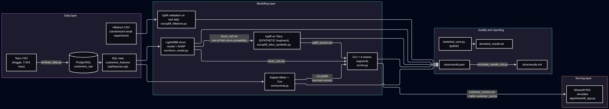
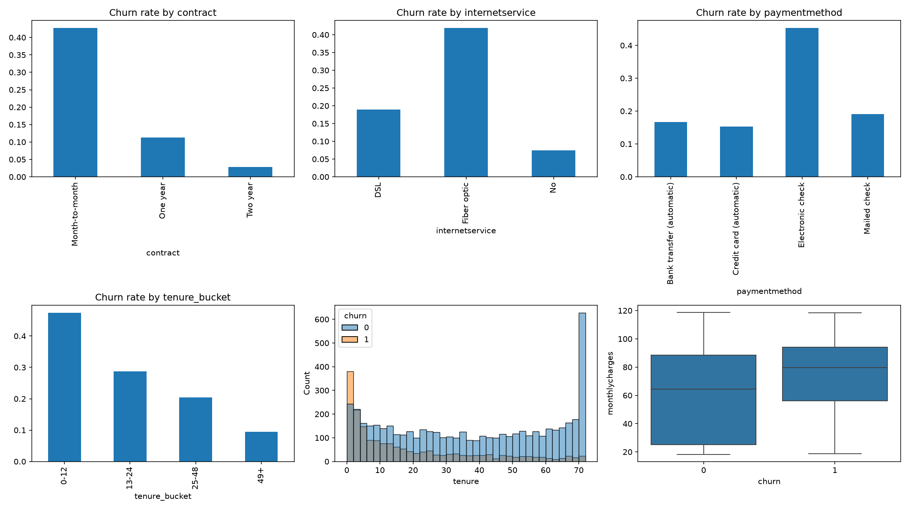
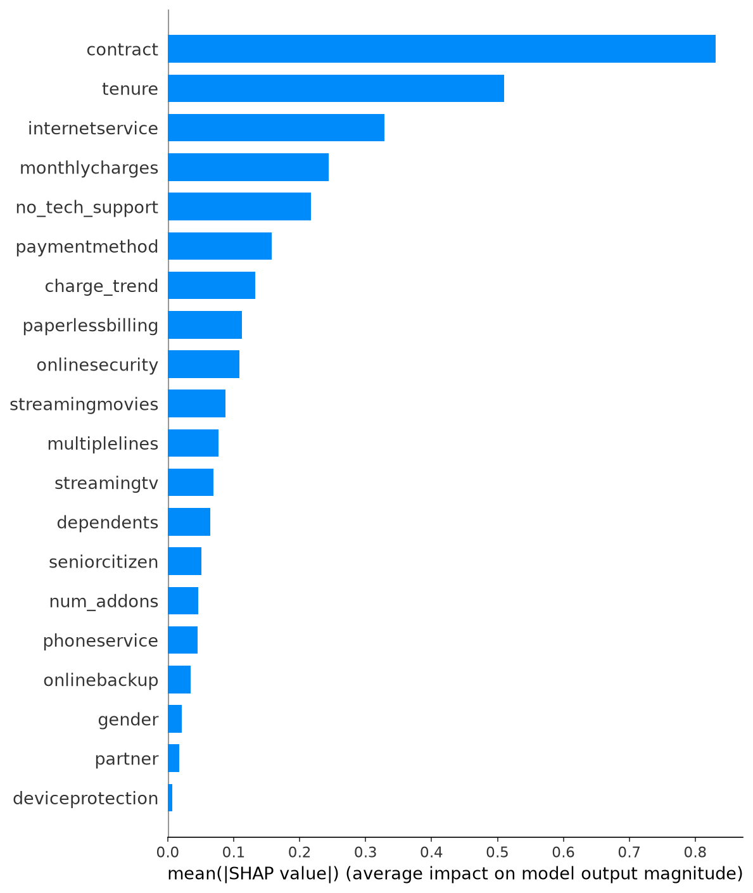
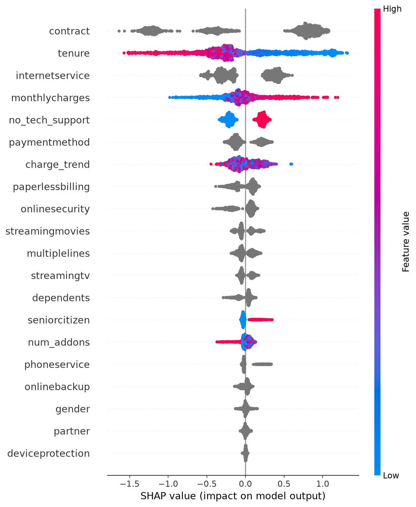
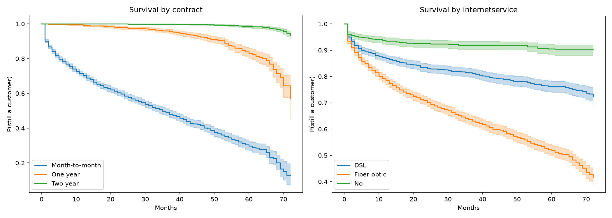
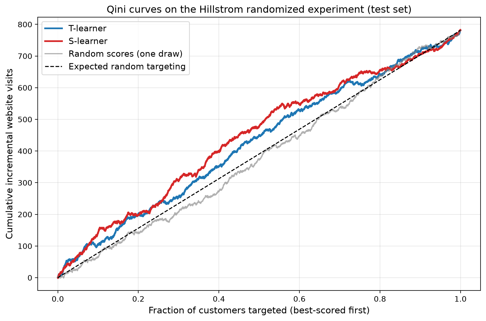
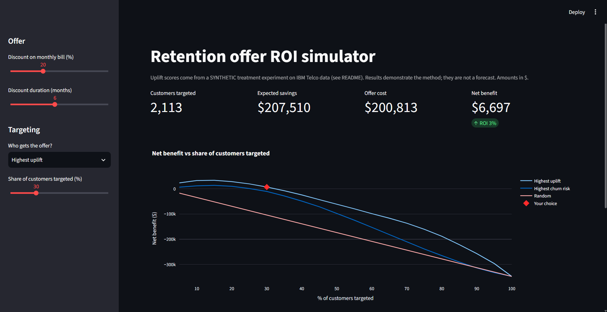

# Customer Lifetime Value and Churn Intelligence System

An end-to-end data science project on the IBM Telco customer dataset. It predicts **who will leave**, **how long customers will stay**, **how much they are worth**, and **which retention offers are worth their cost**, and brings it all together in an interactive ROI simulator.

**Project DS-01** · Specialization track: Data Science
**Author:** Sayantani Manna · **GitHub:** [@astronomertypes](https://github.com/astronomertypes) · **Repository:** https://github.com/astronomertypes/churn-clv-system

---

## Table of contents

1. [The problem](#1-the-problem)
2. [What I built](#2-what-i-built)
3. [Architecture](#3-architecture)
4. [Data](#4-data)
5. [Setup](#5-setup)
6. [Running the project](#6-running-the-project)
7. [Methods and results](#7-methods-and-results)
8. [The ROI simulator](#8-the-roi-simulator)
9. [Tests](#9-tests)
10. [Assumptions](#10-assumptions)
11. [Limitations](#11-limitations)
12. [Next steps](#12-next-steps)
13. [Repository structure](#13-repository-structure)
14. [Troubleshooting](#14-troubleshooting)

---

## 1. The problem

A telecom company loses customers every month. It can offer a discount to keep some of them, but a discount costs money. I set out to answer three questions:

1. **Who is likely to leave?** (churn prediction)
2. **How long will each customer stay, and what are they worth?** (survival analysis and customer lifetime value)
3. **Who will actually change their mind because of an offer?** (uplift modeling). Some customers would stay anyway and some would leave whatever the company does, so a discount given to them is wasted.

The final tool lets a manager choose a discount and see **expected savings versus cost**.

---

## 2. What I built

| Step | What I delivered | Tools |
|---|---|---|
| 1 | Telco data loaded into PostgreSQL, with a SQL feature view | PostgreSQL, SQLAlchemy |
| 2 | EDA and feature engineering (tenure, usage-trend proxy, complaint proxy, contract type) | Pandas, SQL |
| 3 | Churn classifier with explanations | LightGBM, SHAP |
| 4 | Survival curves and per-customer survival estimates | Lifelines (Kaplan-Meier, Cox) |
| 5 | Uplift modeling to find persuadable customers | CausalML |
| 6 | Customer lifetime value and customer segments | Cox survival curves, k-means |
| 7 | Interactive ROI simulator | Streamlit |

---

## 3. Architecture




The full diagram, a script-by-script reference, and the reasoning behind each design decision are in [`docs/architecture.md`](docs/architecture.md). Every table and column is documented in [`docs/data_dictionary.md`](docs/data_dictionary.md).

---

## 4. Data

| Dataset | Used for | Source |
|---|---|---|
| **IBM Telco Customer Churn** (7,043 customers, 21 columns, 26.5% churn) | Everything: database, EDA, churn, survival, CLV, segments, app | Kaggle, "Telco Customer Churn" (`WA_Fn-UseC_-Telco-Customer-Churn.csv`) |
| **Hillstrom MineThatData E-Mail Analytics** (about 64,000 customers, randomized email experiment) | Validating the uplift method on real randomized data | Kaggle or the MineThatData site, "Hillstrom" (saved as `hillstrom.csv`) |

The raw files are not stored in this repository. They go in `data/raw/`.

**A note on the data.** Telco has no complaint records, no usage logs, and no discount experiment, so:
- I approximate **complaints** with `no_tech_support` (internet customers with no tech support).
- I approximate the **usage trend** with `charge_trend` (current monthly charge minus the historical average) and `num_addons`.
- The **treatment for uplift on Telco is simulated**, and I label it as such everywhere. The real randomized evidence comes from Hillstrom.

---

## 5. Setup

**Requirements:** Python 3.11 or 3.12 (I developed on 3.12, Windows), Docker Desktop (or a local PostgreSQL), and Git.

```bash
# 1. Clone
git clone https://github.com/astronomertypes/churn-clv-system.git
cd churn-clv-system

# 2. Create and activate a virtual environment
# Windows PowerShell:
py -3.11 -m venv .venv
.venv\Scripts\Activate.ps1
# Mac / Linux:
# python3.11 -m venv .venv
# source .venv/bin/activate

# 3. Install (causalml first, because it is the most sensitive to versions)
python -m pip install --upgrade pip
pip install causalml
pip install -r requirements.txt
```

If PowerShell blocks activation, run `Set-ExecutionPolicy -Scope CurrentUser RemoteSigned` once. If `causalml` fails to install on Windows, it usually needs Microsoft C++ Build Tools.

```bash
# 4. Place the downloaded data in data/raw/
#    WA_Fn-UseC_-Telco-Customer-Churn.csv
#    hillstrom.csv

# 5. Start PostgreSQL
docker compose up -d
docker ps        # should list a postgres:16 container with status "Up"
```

The database uses user `churn`, password `churn_pw`, database `churndb`, port `5432`. These are local development credentials only. If port 5432 is taken, change the mapping in `docker-compose.yml` to `"5433:5432"` and the port in `src/db.py`.

Without Docker, install PostgreSQL directly and run this in `psql`:
```sql
CREATE USER churn WITH PASSWORD 'churn_pw';
CREATE DATABASE churndb OWNER churn;
```

---

## 6. Running the project

Run everything from the project root, in this order, because later scripts read the outputs of earlier ones.

```bash
docker compose up -d                      # database must be running
python -m src.load_data                   # expect: Loaded 7043 rows, churn rate = 0.265
python -m src.churn_model                 # churn model + SHAP + out-of-fold probabilities
python -m src.survival                    # Kaplan-Meier + Cox
python -m src.uplift_hillstrom            # uplift on the real randomized experiment
python -m src.uplift_telco_synthetic      # uplift on Telco (synthetic treatment)
python -m src.clv                         # CLV + segmentation
python -m src.make_results_md             # builds docs/results.md
python -m pytest -v                       # unit tests
streamlit run app/streamlit_app.py        # opens the ROI simulator
```

- `load_data`, `churn_model`, `survival`, `uplift_telco_synthetic`, and `clv` need PostgreSQL running. The Streamlit app, the Hillstrom script, the tests, and `make_results_md` do not.
- The EDA is in `notebooks/01_eda.ipynb`.
- Every random seed is fixed at 42, so results reproduce.

---

## 7. Methods and results

All numbers are produced by code and saved in [`docs/results.md`](docs/results.md).

### 7.1 Exploratory data analysis



1. Overall churn is **26.5%**, so the classes are imbalanced. That is why I report PR-AUC next to ROC-AUC.
2. Churn depends strongly on contract: about **43%** for month-to-month, **11%** for one-year, and **3%** for two-year.
3. Churn is highest early: about **47%** in the first 12 months, falling to about **9.5%** after 48 months.
4. Fiber-optic customers churn at about **42%**, versus about **19%** for DSL and about **7%** with no internet service.
5. Electronic-check payers churn at about **45%**, versus roughly **15 to 19%** for the other payment methods.
6. Churners pay more per month (median about $80) than non-churners (median about $65).

### 7.2 Churn model (LightGBM) and SHAP

I trained a LightGBM classifier and evaluated it with 5-fold stratified cross-validation plus a separate 20% hold-out set. I deliberately did **not** use class weighting, so the probabilities stay honest for the CLV and ROI steps.

| Metric | Value |
|---|---|
| CV ROC-AUC (5-fold) | **0.843 ± 0.010** |
| CV PR-AUC (5-fold) | **0.656 ± 0.020** |
| Hold-out ROC-AUC | 0.840 |
| Hold-out PR-AUC | 0.651 |
| Hold-out Brier score | 0.138 |
| Baseline PR-AUC (a useless model scores about the positive rate) | about 0.265 |




**What the model learned.** The three most influential features are **contract type** (mean |SHAP| about 0.83), **tenure** (about 0.51), and **internet service type** (about 0.33), followed by monthly charges (about 0.24), my engineered `no_tech_support` flag (about 0.22), and payment method (about 0.16). The dot plot shows that short tenure, higher monthly charges, and having no tech support push predicted churn up, while longer tenure and more add-on services push it down. Gender, partner status, and device protection contribute almost nothing. SHAP draws categorical features in grey, so I took the direction for contract, internet service, and payment method from the EDA and the Cox model: month-to-month, fiber optic, and electronic check increase risk. The ranking agrees with the Cox model, where contract type has by far the largest hazard ratios. It was also reassuring that `no_tech_support`, my complaints proxy, ranked fifth.

### 7.3 Survival analysis (Kaplan-Meier and Cox)

Each customer has a duration (`tenure`) and an event (`churn`). Customers who have not left are *censored*. I dropped the 11 customers with tenure 0, leaving **7,032 customers, 1,869 churn events, and 5,163 censored**.



| Metric | Value |
|---|---|
| Cox concordance index, train | 0.865 |
| Cox concordance index, **held-out 20%** | **0.855** |

(Concordance of 0.5 is random and 1.0 is perfect.)

After 72 months roughly 94% of two-year-contract customers remain, versus about 13% of month-to-month customers. Fiber-optic customers drop fastest (about 42% remain at month 72), DSL is in the middle (about 72%), and customers without internet service are the most stable (about 90%).

Selected Cox hazard ratios (below 1 means lower leaving risk, relative to the baseline category):

| Feature | Hazard ratio | Meaning |
|---|---|---|
| Two-year contract | 0.078 | about 92% lower risk than month-to-month |
| One-year contract | 0.237 | about 76% lower |
| No internet service | 0.372 | about 63% lower |
| Online security | 0.522 | about 48% lower |
| Online backup | 0.527 | about 47% lower |
| Tech support | 0.645 | about 36% lower |
| Partner | 0.603 | about 40% lower |
| Multiple lines | 0.634 | about 37% lower |
| Fiber optic | 1.408 | about 41% higher |
| Paperless billing | 1.212 | about 21% higher |
| Mailed check | 1.669 | about 67% higher |
| Electronic check | 1.755 | about 76% higher |

Monthly charges (p = 0.381), gender, senior citizen, dependents, and phone service showed no clear effect. Monthly charges overlap with internet type and add-ons, so I do not over-interpret individual coefficients. The full table is in `docs/cox_hazard_ratios.csv`.

**Proportional-hazards check.** The assumption was violated for 7 covariates (`multiplelines`, `onlinesecurity`, `onlinebackup`, `techsupport`, `streamingtv`, `contract_One year`, `paymentmethod_Mailed check`), most strongly one-year contract. With about 7,000 customers even small deviations get flagged. I treat the hazard ratios as average effects over time and the survival curves as approximate.

### 7.4 Uplift modeling

**Uplift** measures how much an offer *changes* a customer's behavior. It needs an experiment with randomly assigned treatment, because the same customer can never be observed both with and without the offer.

#### 7.4a Validation on real randomized data (Hillstrom)

In this retail email experiment, customers were randomly sent an email or not. The two groups were nearly identical on every feature, which confirms the randomization. I trained two uplift models (a T-learner and an S-learner, both LightGBM-based) on 70% of the data and tested on 30%.

| Result | Value |
|---|---|
| Visit rate, no email | 0.106 |
| Visit rate, emailed | 0.167 |
| Average uplift | **+0.061** (6.1 percentage points) |
| Qini coefficient, T-learner | 34.5 |
| Qini coefficient, S-learner | 53.1 |
| Qini coefficient, random targeting | -9.6 |



Both models beat random targeting over roughly 5% to 75% of customers targeted. The top predicted-uplift decile showed the largest observed effect (8.3 points). However, the effect was positive in every decile and the decile ordering was noisy (about 640 control customers per decile), so the variation in treatment effect in this dataset is modest. I used a single train/test split, so I do not read much into the difference between the two learners.

This dataset is a retail email campaign, not telecom, so I use it to validate the method only.

#### 7.4b Uplift on Telco with a SYNTHETIC treatment

Telco has no experiment, so I simulated a randomized 20% discount under stated assumptions (see [Assumptions](#10-assumptions)). A T-learner with 5-fold cross-fitting estimated each customer's uplift.

| Result | Value |
|---|---|
| Spearman correlation, estimated vs true uplift | 0.730 |
| Qini coefficient, uplift model | 79.8 |
| Qini coefficient, **churn-risk targeting** | **105.3** |
| Qini coefficient, random | 2.4 |
| Spearman, churn risk vs true uplift (diagnostic) | 0.973 |

**What I found.** The uplift model recovers real signal: it beats random targeting and correlates 0.73 with the true simulated effect. But **simply targeting the highest churn risk scored higher**. My diagnostic explains why. I defined the true effect as proportional to baseline churn probability, so risk and persuadability are almost identical (Spearman 0.973). The simulation has no "lost cause" or "sleeping dog" customers, which is where uplift modeling normally adds value over risk targeting. I did not tune the assumptions to make the uplift model win. The result comes from a single simulated draw and demonstrates the pipeline. It is not evidence about real customers.

### 7.5 Customer lifetime value and segmentation

```
CLV = monthly charge × margin × Σ (k = 1 to 24) [ P(still a customer in month k | still here now) × monthly discount factor ]
```

Survival probabilities come from each customer's Cox curve. I clustered customers with k-means on standardized CLV, tenure, monthly charges, churn probability, and add-on count. Silhouette scores were 0.394 (k = 3), 0.344 (k = 4), 0.327 (k = 5), and 0.331 (k = 6), so I chose **k = 3**. A silhouette near 0.39 indicates moderate structure rather than sharply separated groups.

| Segment | Plain name | Customers | Mean CLV | Mean tenure | Avg bill | Predicted churn | Actual churn | Avg add-ons |
|---|---|---|---|---|---|---|---|---|
| S0: Lower-value / low-risk | Small and steady | 2,360 | $166 | 30 mo | $30 | 0.11 | 0.12 | 0.5 |
| S1: High-value / low-risk | Loyal big spenders | 2,492 | $508 | 53 mo | $88 | 0.14 | 0.14 | 4.0 |
| S2: High-value / high-risk | New and at risk | 2,191 | $352 | 12 mo | $76 | 0.57 | 0.56 | 1.5 |

- **S0** is cheap to serve and rarely leaves, so discount money is wasted here.
- **S1** is the most valuable group. It should be protected and offered upgrades rather than discounts.
- **S2** is the main retention target: new customers with a high bill and about 56% churn. Its CLV ($352) is only just above the overall average (about $345), so I describe it as mid-to-high value.

Predicted churn matches actual churn closely in every segment, which indicates good calibration.

Sanity checks by contract:

| Contract | Mean expected months (of 24) | Mean CLV | Mean churn probability |
|---|---|---|---|
| Month-to-month | 17.5 | $311.67 | 0.43 |
| One year | 21.9 | $383.57 | 0.11 |
| Two year | 23.4 | $388.00 | 0.03 |

One-year and two-year CLV are close because the 24-month horizon compresses the gap. A longer horizon (36 or 60 months) would widen it.

---

## 8. The ROI simulator

Launch it with `streamlit run app/streamlit_app.py`.



**Controls:** discount size (5 to 50%), discount duration (1 to 12 months), targeting strategy (highest uplift, highest churn risk, or random), and the share of customers targeted.

**How it calculates:**
- *Expected savings* = the sum, over targeted customers, of (estimated uplift × scale × CLV). Uplift is scaled linearly with discount size relative to the 20% reference (capped at 2×) and cannot exceed the customer's churn probability.
- *Offer cost* = discount % × monthly charge × months, paid for **every targeted customer**, including those who would have stayed anyway. This is what makes careful targeting valuable.
- *Net benefit* = expected savings − offer cost.

The app updates the headline metrics as any control changes, plots net benefit against the share of customers targeted for all three strategies, and shows which segments are being targeted.

**What I observed.** With a 20% discount for 6 months, targeting by highest uplift gave the best net benefit at almost every share of customers targeted, with highest churn risk close behind and random targeting clearly worst. Net benefit peaked when I targeted only the top 10 to 20% of customers (roughly +$30k) and turned negative beyond about 30 to 35%, because the offer cost is paid for every targeted customer, including those who would have stayed anyway; targeting everyone lost roughly $340k. At my default setting of 30% targeted, the offer cost $200,813 against $207,510 in expected savings, a net benefit of $6,697 (ROI 3%). At a 50% discount, net benefit fell to -$137,424 (ROI -27%).

In the app, uplift targeting came out slightly ahead of risk targeting, unlike in the Qini comparison in section 7.4b. This is likely because the Qini metric counts customers retained, whereas the simulator weighs each customer by lifetime value and offer cost, so the two rankings can differ. The gap is small, and both rely on the synthetic treatment, so the simulator demonstrates the method and is not a forecast.

---

## 9. Tests

I wrote four unit tests (`tests/test_core.py`) for the core logic. All pass: **4 passed** (`docs/test_results.txt`).

| Test | What it verifies |
|---|---|
| `test_clean_merges_no_service_levels` | "No internet service" and "No phone service" are merged into "No" |
| `test_no_churn_gives_full_horizon` | If nobody ever leaves, expected months over 24 months is exactly 24 |
| `test_discounting_reduces_value` | A positive discount rate lowers customer value |
| `test_qini_rewards_good_ranking` | A good ranking scores above zero and a reversed one below zero |

Run them with `python -m pytest -v` (configured by `pytest.ini`; no database needed).

---

## 10. Assumptions

| Assumption | Value | Where |
|---|---|---|
| Profit margin on monthly charges | 30% | `src/clv.py` |
| Annual discount rate | 10% | `src/clv.py` |
| CLV horizon | 24 months | `src/clv.py` |
| Survival beyond month 72 | Held flat | `src/clv.py` |
| Reference offer | 20% discount on the monthly bill | `src/uplift_telco_synthetic.py` |
| Treatment assignment | Random, 50% treated (synthetic) | `src/uplift_telco_synthetic.py` |
| Reduction in churn probability if offered | 45% for month-to-month customers with above-median charges, 25% for other month-to-month customers, 5% for everyone else (synthetic) | `src/uplift_telco_synthetic.py` |
| Uplift vs discount size in the app | Linear, capped at 2× the reference | `app/streamlit_app.py` |
| Complaints proxy | `no_tech_support` | `sql/features.sql` |
| Usage-trend proxies | `charge_trend`, `num_addons` | `sql/features.sql` |
| Random seed | 42 everywhere | all scripts |

All assumptions are constants in the code, and changing them changes the downstream results.

---

## 11. Limitations

1. **Proxies, not real signals.** Telco has no complaints or usage data, so `no_tech_support`, `charge_trend`, and `num_addons` are stand-ins.
2. **Synthetic uplift on Telco.** The "true" effects are assumptions I defined, so the uplift model partly rediscovers a rule I wrote into the simulation. The Telco uplift results demonstrate the pipeline and are not evidence about real customers.
3. **Risk targeting scored higher on the Qini metric in my simulation**, because I built true uplift to track churn risk (Spearman 0.973), although uplift targeting was slightly ahead in the ROI simulator..
4. **Hillstrom is a different domain** (retail email). It validates the method on real randomized data but cannot feed the telecom ROI app. Its uplift signal is modest, and I used a single split without error bars.
5. **Proportional-hazards violations** in 7 Cox covariates mean the hazard ratios are time-averaged and the survival curves approximate.
6. **Right-tail extrapolation.** Survival is observed only to month 72 and I hold it flat afterward, which can slightly overvalue very long-tenure customers. The one-year Kaplan-Meier curve is also wide and unstable after about month 65 because few customers remain.
7. **Contract is the customer's current contract**, and multi-year contracts partly cause low churn through lock-in. The contract effect therefore mixes customer preference with contractual lock-in.
8. **Correlated features.** Monthly charges raise churn risk in SHAP but show no clear effect in Cox, because charges overlap with internet type and add-ons. Single-feature effects should not be read causally.
9. **Moderate clustering structure** (silhouette 0.394), so segment boundaries are not sharp.
10. **Not production software.** There is no monitoring, retraining, or API, and the database credentials are local development values.

---

## 12. Next steps

- Validate the ROI logic on a **real randomized retention experiment** (an actual discount test).
- Simulate a richer scenario with **lost-cause and sleeping-dog segments**, where uplift targeting is expected to outperform risk targeting.
- Add **error bars** (repeated splits or bootstrap) to the uplift comparisons.
- Fix the proportional-hazards violations by **stratifying the Cox model** (for example by contract) or using time-varying effects.
- Extend the CLV horizon to 36 or 60 months and add a sensitivity analysis on margin and discount rate.
- Try the **bank churn** or **Criteo uplift** datasets listed in the project brief.
- Wrap the scoring in an API and deploy the app.

---

## 13. Repository structure

```
churn-clv-system/
├── README.md
├── docker-compose.yml          # PostgreSQL 16
├── requirements.txt
├── pytest.ini
├── .gitignore
├── data/
│   ├── raw/                    # downloaded CSVs (not committed)
│   └── processed/              # churn_oof.csv, uplift_scores.csv, customer_scores.csv
├── sql/
│   └── features.sql            # view customers_features
├── notebooks/
│   └── 01_eda.ipynb
├── src/
│   ├── db.py                   # database connection
│   ├── load_data.py            # CSV -> PostgreSQL
│   ├── features.py             # shared feature definitions
│   ├── churn_model.py          # LightGBM + SHAP
│   ├── survival.py             # Kaplan-Meier + Cox
│   ├── metrics.py              # Qini functions
│   ├── uplift_hillstrom.py     # uplift on the real experiment
│   ├── uplift_telco_synthetic.py
│   ├── clv.py                  # CLV + clustering
│   ├── results.py              # saves metrics to JSON
│   └── make_results_md.py      # JSON -> results.md
├── app/
│   └── streamlit_app.py        # ROI simulator
├── models/                     # saved model files
├── docs/
│   ├── architecture.md / .mmd / .png
│   ├── data_dictionary.md
│   ├── results.md / results.json
│   ├── test_results.txt
│   └── *.png, *.csv            # charts and tables
└── tests/
    └── test_core.py
```

---

## 14. Troubleshooting

| Problem | Cause | Fix |
|---|---|---|
| `connection refused` on port 5432 | PostgreSQL is not running | Open Docker Desktop, then run `docker compose up -d` |
| `relation "customers_features" does not exist` | Database is empty | Run `python -m src.load_data` |
| `ModuleNotFoundError: No module named 'src'` | Wrong folder, or a script was run directly | Run from the project root with `python -m src.<name>` |
| `pytest` cannot import `src` | Missing `pytest.ini` | Keep `pytest.ini` in the project root and use `python -m pytest` |
| `UnicodeDecodeError` from pytest | A UTF-16 file in `docs/` created by a PowerShell `>` redirect | Delete it, keep `testpaths = tests` in `pytest.ini`, and write files with `Out-File -Encoding utf8` |
| `causalml` fails to install | Build tools or Python version | Install Microsoft C++ Build Tools, use Python 3.11, or run the uplift step in Google Colab |
| PowerShell blocks venv activation | Execution policy | `Set-ExecutionPolicy -Scope CurrentUser RemoteSigned` |

---

## Acknowledgements and data sources

- IBM Telco Customer Churn dataset (Kaggle).
- Hillstrom, K. *MineThatData E-Mail Analytics and Data Mining Challenge* (2008).
- Libraries: pandas, scikit-learn, LightGBM, SHAP, Lifelines, CausalML, Streamlit, SQLAlchemy, Plotly.
