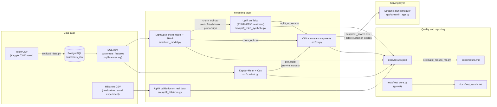

# Architecture

**Author:** Sayantani Manna

This document explains how I built the system: where the data lives, which script reads and writes what, and why I connected the pieces the way I did.

## 1. System diagram

The same diagram is saved as plain Mermaid source in [`architecture.mmd`](architecture.mmd).

## 2. How the system is organised

I split the system into four layers. Each layer depends only on the one before it.

| Layer | What it does | Why I separated it |
|---|---|---|
| **Data** | Loads the raw CSV into PostgreSQL and computes engineered features inside the database with a SQL view. | One source of truth. Every model reads the same cleaned table, so the models cannot disagree about a feature. |
| **Modelling** | Four analyses: churn probability, survival time, uplift, and lifetime value with clustering. | Each analysis is its own script, so it can be re-run and tested on its own. |
| **Serving** | The Streamlit app reads one CSV (`customer_scores.csv`). | The app needs no database, so it runs on any machine and can be screen-recorded easily. |
| **Quality and reporting** | Every metric is saved from code into `docs/results.json` and turned into `docs/results.md`. Unit tests check the core maths. | Numbers in the README come from code and are never typed by hand, so they cannot drift from the results. |

## 3. Script-by-script reference

| Script | Reads | Writes | Needs the database? |
|---|---|---|---|
| `src/load_data.py` | `data/raw/WA_Fn-UseC_-Telco-Customer-Churn.csv`, `sql/features.sql` | Table `customers_raw`; view `customers_features` | Yes |
| `src/db.py` | n/a | Helpers: `get_engine()`, `load_features()` | n/a |
| `src/features.py` | n/a | Helpers: feature lists, `clean()`, `gbm_frame()`, `onehot_frame()` | No |
| `src/churn_model.py` | view `customers_features` | `data/processed/churn_oof.csv`, `models/churn_lgbm.joblib`, `docs/shap_summary.png`, `docs/shap_importance.png`, metrics in `docs/results.json` | Yes |
| `src/survival.py` | view `customers_features` | `models/cox.joblib`, `docs/km_curves.png`, `docs/cox_hazard_ratios.csv`, metrics | Yes |
| `src/uplift_hillstrom.py` | `data/raw/hillstrom.csv` | `docs/qini_hillstrom.png`, `docs/uplift_deciles_hillstrom.csv`, metrics | No |
| `src/uplift_telco_synthetic.py` | view `customers_features`, `churn_oof.csv` | `data/processed/uplift_scores.csv`, metrics | Yes |
| `src/clv.py` | view `customers_features`, `cox.joblib`, `churn_oof.csv`, `uplift_scores.csv` | `data/processed/customer_scores.csv`, table `customer_scores`, `docs/segment_profiles.csv`, metrics | Yes |
| `src/metrics.py` | n/a | Helpers: `qini_curve()`, `qini_coefficient()` | No |
| `src/results.py` | n/a | Helper: `save_metrics()` writes `docs/results.json` | No |
| `src/make_results_md.py` | `docs/results.json` | `docs/results.md` | No |
| `app/streamlit_app.py` | `data/processed/customer_scores.csv` | Interactive dashboard | No |
| `tests/test_core.py` | n/a | pytest results | No |

The run order matters. `clv.py` needs the outputs of `churn_model.py`, `survival.py`, and `uplift_telco_synthetic.py`, and the app needs `clv.py`.

## 4. How one customer flows through the system

Take one example customer: month-to-month contract, fiber optic internet, 3 months of tenure.

1. **Data layer:** the row is loaded into `customers_raw`. The SQL view adds `num_addons`, `no_tech_support`, `charge_trend`, and `tenure_bucket`.
2. **Churn model:** LightGBM gives the customer a churn probability. The number comes from a model that never saw this customer in training (out-of-fold).
3. **Survival model:** the Cox model gives the customer a personal survival curve: the chance they are still a customer at month 4, 5, 6, and so on.
4. **Uplift:** the synthetic-treatment model estimates how much a 20% discount would reduce the chance of leaving.
5. **CLV:** the survival curve is turned into expected months over the next 24 months, discounted, and multiplied by monthly charge and margin.
6. **Segmentation:** k-means places the customer in one of three segments using CLV, tenure, bill, churn probability, and add-ons.
7. **App:** the ROI simulator combines the customer's uplift, churn probability, CLV, and monthly charge to estimate whether an offer is worth its cost.

## 5. Design decisions and why I made them

| Decision | Reason |
|---|---|
| **Features computed in a SQL view** | Keeps the feature logic in one place and uses PostgreSQL as the brief requires. No model can use a different version of a feature. |
| **No class weighting in LightGBM** | CLV and the ROI app need honest probabilities, and class weighting inflates them. I checked calibration: predicted churn per segment (0.11, 0.14, 0.57) closely matches observed churn (0.12, 0.14, 0.56). |
| **Out-of-fold (OOF) churn probabilities** | Each customer is scored by a model that did not train on them. In-sample scores would be too optimistic and would leak into CLV and uplift. |
| **Cross-fitting for uplift** | Same principle: each customer's uplift comes from a model that never saw them. |
| **Tenure, charge_trend, num_addons, and no_tech_support excluded from the Cox model** | Tenure is the duration itself. The others are built from tenure or are exact combinations of other columns, which would leak duration or make the design matrix singular. |
| **Hand-written Qini functions** | They do not depend on library-version quirks, and I unit-tested them. |
| **App reads a CSV, not the database** | The demo works anywhere without Docker. |
| **Hillstrom used only for validation** | Telco has no real treatment column. Hillstrom is a real randomized experiment, so it shows the uplift method on genuine data. It is a different domain (retail email), so I did not mix it into the Telco pipeline. |
| **Synthetic treatment on Telco, clearly labelled** | I needed it to power the ROI simulator. The results demonstrate the pipeline and are not evidence about real customers. |

## 6. Limits of this architecture

- Telco has no complaints or usage data. `no_tech_support`, `charge_trend`, and `num_addons` are **proxies**.
- The Cox model violates the proportional-hazards assumption for 7 covariates, so hazard ratios are average effects over time.
- Survival is observed only up to month 72. Beyond that I hold the curve flat, which can slightly overvalue very long-tenure customers.
- The synthetic uplift was built so that true uplift is almost identical to churn risk (Spearman 0.973), so risk targeting beat the uplift model in my simulation.
- There is no model monitoring, retraining, or API. This is an analysis and demo system, not a production service.
