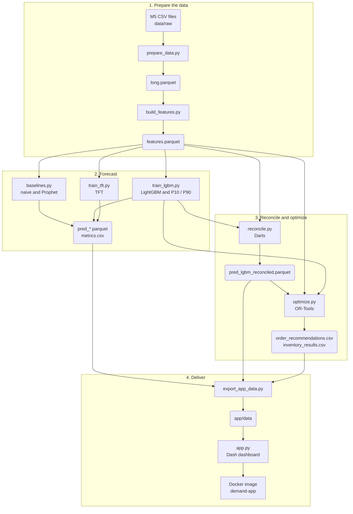
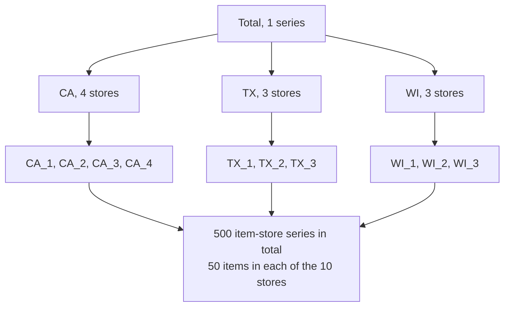
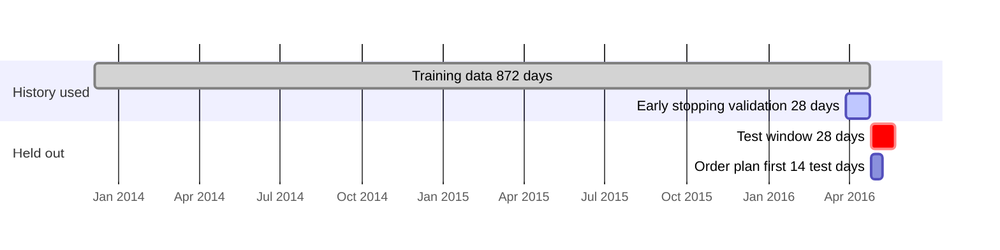
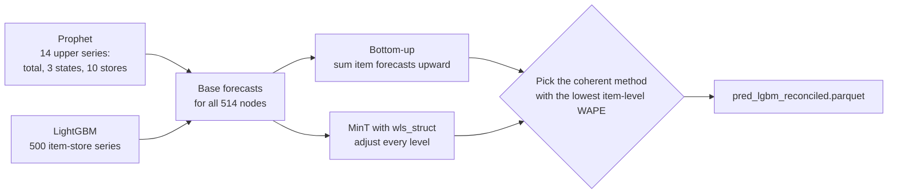
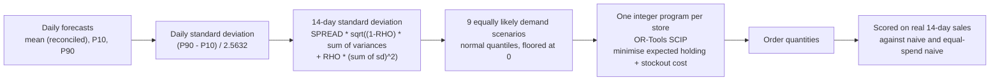
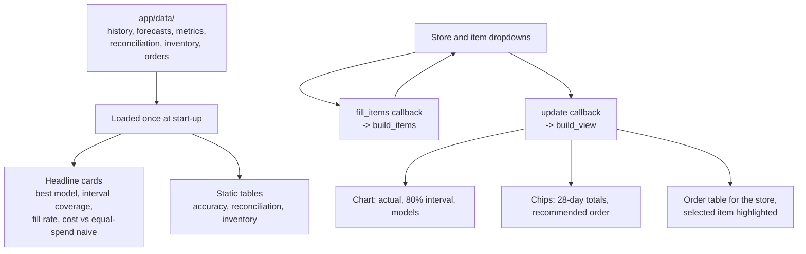

# Architecture

This document explains how my demand forecasting and inventory optimization project is built: the pipeline, the data hierarchy, the train and test split, the optimization model, the dashboard, and the reasons behind my main design choices. The overview and results are in the [README](../README.md), and every file and column is described in [DATA_DICTIONARY.md](DATA_DICTIONARY.md).

## Contents

1. [Pipeline overview](#1-pipeline-overview)
2. [Components](#2-components)
3. [The hierarchy](#3-the-hierarchy)
4. [Train, validation and test periods](#4-train-validation-and-test-periods)
5. [Forecasting design](#5-forecasting-design)
6. [Reconciliation design](#6-reconciliation-design)
7. [Optimization design](#7-optimization-design)
8. [Dashboard design](#8-dashboard-design)
9. [Docker and deployment](#9-docker-and-deployment)
10. [Interfaces (functions I wrote)](#10-interfaces-functions-i-wrote)
11. [Design decisions and trade-offs](#11-design-decisions-and-trade-offs)

---

## 1. Pipeline overview

Each script does one job and writes files that the next script reads. Nothing is hidden in memory between scripts, so I can rerun any single step.



Rectangles are scripts and rounded boxes are files. The diagnostic scripts `check_scenarios.py` and `check_tft.py` are not in the diagram: they only read the files above and print numbers.

---

## 2. Components

| Script | Reads | Writes | What it does |
|---|---|---|---|
| `src/utils.py` | | | Paths, the `wape` and `rmsse` metrics, `evaluate` and `save_metrics` helpers used by every model script |
| `src/prepare_data.py` | `data/raw/*.csv` | `data/processed/long.parquet` | Keeps FOODS_3, the 50 best-selling items and the last 900 days. Reshapes to one row per item, store and day. Adds calendar, price, `on_sale` and `snap` |
| `src/build_features.py` | `long.parquet` | `features.parquet` | Lags, rolling statistics, price ratio, promo proxy, calendar features, integer codes and the `is_test` flag |
| `src/baselines.py` | `features.parquet` | `pred_naive.parquet`, `pred_prophet.parquet`, `metrics.csv` | Seasonal naive and one Prophet model per series |
| `src/train_lgbm.py` | `features.parquet` | `pred_lgbm.parquet`, `metrics.csv`, `lgbm_importance.csv`, `interval_coverage.txt` | One global LightGBM model plus 10% and 90% quantile models |
| `src/train_tft.py` | `features.parquet` | `pred_tft.parquet`, `metrics.csv`, `tft_ckpt/` | Temporal Fusion Transformer with quantile output |
| `src/reconcile.py` | `features.parquet`, `pred_lgbm.parquet` | `pred_lgbm_reconciled.parquet`, `reconciliation_metrics.csv` | Prophet for the 14 upper nodes, then Darts reconciliation (bottom-up and MinT). Checks that every link of the hierarchy adds up |
| `src/optimize.py` | `features.parquet`, `pred_lgbm.parquet`, `pred_lgbm_reconciled.parquet` | `order_recommendations.csv`, `inventory_results.csv` | Builds demand scenarios, solves one integer program per store, scores the policies on real sales |
| `src/check_scenarios.py` | same as `optimize.py` | prints only | Checks whether the demand scenarios are as wide as the real forecast errors |
| `src/check_tft.py` | `features.parquet`, the four `outputs/pred_*.parquet` files | prints only | Bias of every model's total forecast, and interval coverage and width of LightGBM and the TFT |
| `src/export_app_data.py` | `features.parquet`, `outputs/*` | `app/data/*` | Collects the small files the dashboard needs |
| `app/app.py` | `app/data/*` | | The Plotly Dash dashboard |
| `tests/test_core.py` | `src/utils.py`, `src/optimize.py` | | Unit tests for metrics, scenarios, the cost function and the optimizer |
| `tests/test_app.py` | `app/app.py`, `app/data/*` | | Smoke tests for the dashboard logic |
| `Dockerfile` | `app/` | image `demand-app` | Packs the dashboard |

---

## 3. The hierarchy

The M5 data is hierarchical: items sold in stores, stores in states. I added a total on top, so the hierarchy has 514 nodes: 1 total, 3 states, 10 stores and 500 item-store series (50 items in each of the 10 stores).



In `reconcile.py` the hierarchy is a dictionary that maps every node to its parent: each item-store series maps to its store, each store to its state and each state to `total`. Node names are the series id for item-store series, the store id (for example `CA_1`) for stores, the state code (`CA`, `TX`, `WI`) for states and `total` for the top.

---

## 4. Train, validation and test periods



The date range comes from the output of `python src/prepare_data.py`: 5 December 2013 (d_1042) to 22 May 2016 (d_1941), 900 days.

- **Training data:** the first 872 of the 900 days.
- **Test window:** the last 28 days (d_1914 to d_1941). No model sees them during training.
- **Validation window:** the last 28 training days. LightGBM uses them to choose the number of trees (147), and the TFT uses them for early stopping. After choosing the number of trees, LightGBM is refit on all training data.
- **Order plan:** the optimizer plans for the first 14 days of the test window and is scored on what really sold in those 14 days.

### Leakage rule

Every lag and rolling feature is shifted by at least 28 days. A test day's features therefore only use sales from at least 28 days earlier, which are all before the test window. This means one model can serve every horizon from 1 to 28 days without needing future sales. Price, calendar and SNAP features are known in advance, so they are allowed.

---

## 5. Forecasting design

| Model | Input | Output | Notes |
|---|---|---|---|
| Seasonal naive | last 7 training days of each series | 28-day point forecast | Repeats the weekday pattern |
| Prophet | one series at a time | 28-day point forecast | 500 separate fits, weekly and yearly seasonality plus US holidays, no price features |
| LightGBM | 22 features (lags, rolling statistics, price, calendar, codes) | point forecast and 10%, 90% quantiles | One global model for all series, Tweedie loss with variance power 1.1, 147 trees, about 408,000 training rows |
| TFT | 56-day history plus known future inputs | median and 10%, 90% quantiles | 25,858 parameters, hidden size 16, 2 attention heads, quantile loss, at most 10 epochs of 400 batches of 128 windows, CPU only |

All four models write the same shape of output (`id`, `date`, `pred`, and `lo`, `hi` where available), which is why the dashboard and the metrics code can treat them the same way.

Evaluation uses WAPE at item-store level, WAPE at store level (item forecasts and actuals summed per store and day first) and RMSSE (the mean over the 500 series, scaled by a one-step naive forecast on the training data). This RMSSE is a simple average, not the official M5 WRMSSE, so my numbers are not comparable with the Kaggle leaderboard.

---

## 6. Reconciliation design



- The upper levels and the bottom level come from different models on purpose. Their disagreement is what reconciliation fixes.
- The **coherence gap** is the largest absolute difference, over all 28 days, between a forecast and the sum of its parts. `coherence_by_link` in `reconcile.py` measures each link separately: items against their store, stores against their state and states against the total. `coherence_gap` is the largest of the three and is the value saved in `reconciliation_metrics.csv`. For the base forecasts the three links were 241.0, 25.3 and 15.8 units per day. After reconciliation all three are 0.
- In the Darts version I use (0.48.1) reconciliation is split into separate classes: `BottomUpReconciliator` and `MinTReconciliator` (with `method="wls_struct"`).
- Bottom-up won (best WAPE at every level), so the reconciled item-store forecast equals LightGBM's. Reconciliation therefore improves the upper levels, not the item level.
- Reconciliation works on point forecasts only. The prediction intervals are not reconciled.

---

## 7. Optimization design



### Scenario construction

```
daily sd_t     = (hi_t - lo_t) / (2 * 1.2816)            # 80% interval = mean +/- 1.2816 sd
sd_window      = SPREAD * sqrt( (1 - RHO) * sum_t sd_t^2 + RHO * (sum_t sd_t)^2 )
D_ik           = max( mean_i + z_k * sd_window_i , 0 )    # z_k = normal quantile at (k - 0.5) / 9, k = 1..9
```

`RHO = 0.2` says that daily forecast errors partly move together. `SPREAD = 1.2` widens the scenarios so that the standardized errors on the test window have standard deviation 1.0. Both are assumptions, listed in the README.

### The integer program (one per store)

```
For one store, items i = 1..50, scenarios k = 1..9, each scenario with probability 1/9:

minimise    sum_i sum_k (1/9) * ( h_i * over_ik + s_i * under_ik )

subject to  on_hand_i + q_i - D_ik = over_ik - under_ik      for every item i and scenario k
            sum_i c_i * q_i <= B                              (budget of the store)
            0 <= q_i <= ub_i,  q_i integer
            over_ik >= 0,  under_ik >= 0

q_i      units to order (the decision)
D_ik     demand of item i in scenario k over the 14-day plan
c_i      unit cost            = 0.70 * price_i
h_i      holding cost per leftover unit  = 0.05 * c_i
s_i      cost per unit of unmet demand   = price_i - c_i   (lost margin)
B        budget               = 0.85 * sum_i c_i * max(P90_i - on_hand_i, 0)
ub_i     maximum order        = ceil(1.5 * P90_i)
on_hand_i  assumed current stock = round(2 * mean_i / 14)   (2 days of expected demand)
```

Size per store: 50 integer variables, 450 `over` and 450 `under` variables, 450 equality constraints and 1 budget constraint. SCIP is given 30 seconds per store.

### How the plan is scored

For each item, `available = on_hand + q`. Against the real demand `actual` over the 14 days:

```
holding_cost   = sum h_i * max(available_i - actual_i, 0)
stockout_cost  = sum s_i * max(actual_i - available_i, 0)
total_cost     = holding_cost + stockout_cost
fill_rate      = sum min(available_i, actual_i) / sum actual_i
order_spend    = sum c_i * q_i
```

Three policies are compared: **Naive** (order the expected demand minus stock on hand, no budget), **Naive scaled to the same spend** (the naive order multiplied, store by store, so that its spend equals the optimizer's spend) and **Optimized**. The equal-spend policy is the fair comparison. Order spend is not part of the cost totals, so comparing policies with different spend would be misleading.

---

## 8. Dashboard design

`app/app.py` reads only the small files in `app/data/`, so it needs no PyTorch, Prophet or raw data.



- **Two callbacks.** `fill_items` fills the item dropdown for the chosen store and keeps the current item when it exists in the new store. `update` returns five outputs: the figure, the chart title, the chips, the order table data and the order table row highlighting.
- **Logic in plain functions.** The callbacks only call `build_items` and `build_view`, so `tests/test_app.py` can test them without a browser.
- **One line for LightGBM.** Because bottom-up reconciliation leaves item forecasts unchanged, the chart shows one line labelled "LightGBM (= reconciled)" instead of two identical lines. If the reconciliation method ever changes the forecasts, the chart draws both.
- **Styling.** Dark lavender, purple and pink theme set through CSS in the page template, Plotly layout settings and `dash_table` style properties.

---

## 9. Docker and deployment


- The image installs only `dash`, `plotly`, `pandas`, `pyarrow` and `gunicorn`, and copies the `app/` folder.
- Build and run: `docker build -t demand-app .` and `docker run --rm -p 8050:8050 demand-app`.
- If I rerun the pipeline, I must rerun `python src/export_app_data.py` and rebuild the image, because the data is copied into the image at build time.

I built the image and ran the container successfully, and the dashboard opens at http://localhost:8050. I have not deployed it to a public web host.

---

## 10. Interfaces (functions I wrote)

The project has no external web API. These are the interfaces between my own scripts.

### `src/utils.py`

| Function | Inputs | Returns |
|---|---|---|
| `wape(y, yhat)` | actual and forecast arrays | `sum(abs(y - yhat)) / sum(abs(y))` as a float |
| `rmsse(y_train, y_true, y_pred)` | training history, test actuals, test forecast of one series | RMSE of the forecast divided by the RMSE of a one-step naive forecast on the training data (leading zeros removed). `NaN` if the scale is 0 or there are fewer than 2 points |
| `evaluate(pred, train, name)` | `pred` with columns `id`, `store_id`, `date`, `sales`, `pred`; `train` with `id`, `sales`; a model name | dictionary with `model`, `WAPE_item_store`, `WAPE_store`, `RMSSE` |
| `save_metrics(row)` | the dictionary from `evaluate` | writes or replaces the model's row in `outputs/metrics.csv` and prints the table |

### `src/optimize.py`

| Function | Inputs | Returns |
|---|---|---|
| `build_scenarios(w)` | daily forecasts with columns `id`, `pred_rec`, `lo`, `hi` | one row per `id` with `d_mid`, `sd`, `d_lo`, `d_hi` for the plan window |
| `add_scenarios(d, k=9)` | table with `d_mid` and `sd` | the same table with columns `s_0` to `s_8` (equally likely demand scenarios) |
| `solve_store(d, budget, time_limit_ms=30000)` | one store's items with `cost`, `hold`, `short`, `on_hand`, `ub` and the scenario columns; the budget | integer order quantity per row (a pandas Series with the same index) |
| `realized(d, q, label)` | items with `actual`, `on_hand`, `hold`, `short`, `cost`; an order vector | dictionary with `policy`, `holding_cost`, `stockout_cost`, `total_cost`, `fill_rate`, `order_spend` |

### `src/reconcile.py`

| Function | Inputs | Returns |
|---|---|---|
| `coherence_by_link(f)` | a forecast table with one column per node of the hierarchy (514 columns) and one row per day | dictionary with the largest daily mismatch (units) for `items -> store`, `stores -> state` and `states -> total` |
| `coherence_gap(f)` | the same table | the largest of the three numbers. This is the value saved in `reconciliation_metrics.csv` |

### `app/app.py`

| Function | Inputs | Returns |
|---|---|---|
| `build_items(store, current)` | store id, currently selected item | the item list of that store and the item to select |
| `build_view(store, item)` | store id, item id | figure, chart title, chips, order table records, order table row styles. Raises `PreventUpdate` for an unknown combination |
| `make_figure(h, f)` | history and forecast rows of one series | the Plotly figure |

---

## 11. Design decisions and trade-offs

| Decision | Why I chose it | Trade-off |
|---|---|---|
| Subset of 500 series | Several models, including a neural network, had to train on a laptop CPU within 14 days | Results may not carry over to all 30,000 series |
| One global LightGBM model | It learns from all series at once and trains in seconds | Less tuning per item |
| Features shifted by 28 days or more | One model for all horizons, and no leakage | The most recent 27 days of sales are not used as features |
| Tweedie loss for LightGBM | Sales are non-negative counts with many zeros | Needs the variance power to be chosen (1.1) |
| Quantile models for intervals | Simple, and LightGBM's 80% interval covered 82.3% of real sales (the TFT's own interval covered 73.7%, so the optimizer uses LightGBM's) | The intervals are not reconciled |
| Small TFT, 10 epochs, CPU | Fits the time budget (about 76 seconds per epoch) | Probably under-trained. 20 epochs was not better, but a longer run on a GPU was not tried |
| Reconciliation method chosen by a rule (best item-level WAPE among coherent methods) | Objective, and repeatable | It picked bottom-up, which leaves item forecasts unchanged |
| 9 demand scenarios per item | 3 scenarios made the solver put most items exactly on a scenario value, and the optimizer lost to a simple baseline | A bigger model, still quick to solve |
| One integer program per store | Budgets are per store, so stores are independent and each problem is small | No transfers between stores |
| Equal-spend naive baseline | The first comparison hid the fact that the optimizer simply ordered more | One more policy to explain |
| Dashboard reads exported files only | Small Docker image and fast start | The export script and the image must be rerun after the pipeline |
