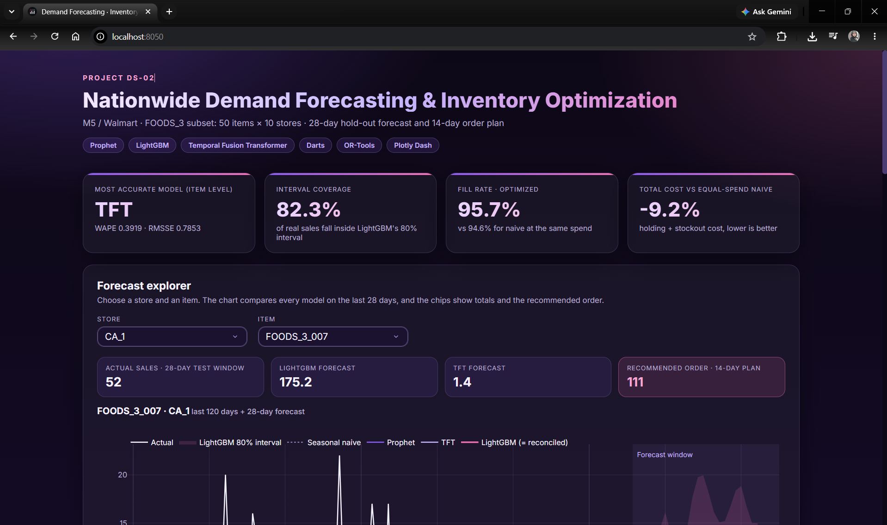
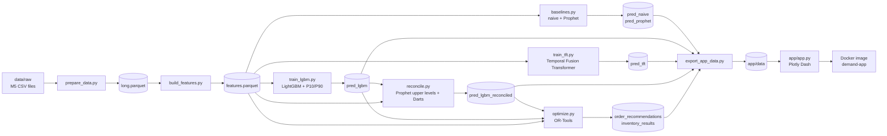

# Nationwide Demand Forecasting and Inventory Optimization

An end-to-end data science project on the Walmart M5 sales data (50 food items in 10 stores). It predicts **how many units each store will sell**, with prediction intervals, keeps those forecasts **consistent across items, stores and states**, works out **how much stock to order**, and brings it all together in an interactive Plotly Dash dashboard.

**Project DS-02** · Specialization track: Data Science  
**Author:** Sayantani Manna · **GitHub:** [@astronomertypes](https://github.com/astronomertypes) · **Repository:** https://github.com/astronomertypes/demand-forecasting



---

## 1. What this project does

A store has to decide, for every product, how much to order. If I order too little, shelves run empty and I lose sales. If I order too much, stock sits unsold and I pay to hold it.

I built an end-to-end pipeline that:

1. **Forecasts** 28 days of daily demand for 500 item-store series using four models: a seasonal naive baseline, Prophet, LightGBM and a Temporal Fusion Transformer (TFT).
2. Produces **prediction intervals** (an 80% range), not just a single number.
3. **Reconciles** forecasts across the hierarchy item-store → store → state → total, so that items add up to their store, stores add up to their state and states add up to the total (Darts). I check every one of these links.
4. Uses **OR-Tools** to choose order quantities that minimise expected holding plus stockout cost under a spending budget per store.
5. Shows everything in a **Plotly Dash** dashboard, packaged in **Docker**.

I used the M5 Forecasting (Walmart) dataset from Kaggle.

---

## 2. Results at a glance

All numbers are measured on a 28-day hold-out period (25 April 2016 to 22 May 2016) that no model saw during training. Lower is better for every column.

### Forecast accuracy

| Model | WAPE item-store | WAPE store | RMSSE |
|---|---|---|---|
| Seasonal naive | 0.4666 | 0.1163 | 0.9273 |
| Prophet | 0.4626 | 0.1276 | 0.8529 |
| LightGBM | 0.4097 | **0.1004** | 0.7941 |
| Temporal Fusion Transformer | **0.3919** | 0.1293 | **0.7853** |

- The TFT is the most accurate for individual item-store series (about 16% lower item-level WAPE than the seasonal naive baseline). LightGBM is the most accurate once forecasts are added up to the store level.
- LightGBM's 80% prediction interval contained **82.3%** of real sales (target is 80%).

### Hierarchical reconciliation

Before reconciliation the forecasts did not add up: the largest daily mismatch between a forecast and the sum of its parts was **241 units** (items against their store), 25 units for stores against their state and 16 units for states against the total. After reconciliation every mismatch is **0**, and accuracy at the upper levels also improved (total-level WAPE 0.0817 → 0.0584).

### Inventory optimization (14-day order plan, measured on what really sold)

| Policy | Holding cost | Stockout cost | Total cost | Fill rate | Order spend |
|---|---|---|---|---|---|
| Naive (order the forecast mean, no budget) | 656 | 6,697 | 7,353 | 87.8% | 102,135 |
| Naive scaled to the same spend | 1,572 | 3,051 | 4,623 | 94.6% | 128,966 |
| **Optimized (OR-Tools)** | **1,527** | **2,670** | **4,197** | **95.7%** | 128,956 |

The fair comparison is the last two rows, because they spend the same money. At equal spend the optimizer has about **9.2% lower total cost**, about **12.5% lower stockout cost** and a fill rate **1.1 percentage points higher**. This is one 14-day window, so I treat it as encouraging evidence, not proof (see Limitations).

Full numbers, experiment history and diagnostics are in [`docs/RESULTS.md`](docs/RESULTS.md).

---

## 3. Data and scope

**Source:** [M5 Forecasting - Accuracy](https://www.kaggle.com/competitions/m5-forecasting-accuracy) (Kaggle, Walmart). I use three raw files: `calendar.csv`, `sell_prices.csv` and `sales_train_evaluation.csv`.

**M5 hierarchy:** item → store → state. There are 3 states (CA, TX, WI) and 10 stores (CA_1 to CA_4, TX_1 to TX_3, WI_1 to WI_3).

**My subset.** The full dataset has about 30,000 items × 10 stores, which is too heavy to train several models, including a deep model, on a laptop CPU within the 14-day effort. So I used:

- department **FOODS_3** only,
- the **50 best-selling items** (by units sold in the last 365 days of the data),
- all **10 stores**, giving **500 item-store series**,
- the most recent **900 days** of history (5 December 2013 to 22 May 2016, about 2.5 years),
- the last **28 days (25 April to 22 May 2016)** as the test period.

That gives 450,000 rows in `long.parquet` and 14,000 test rows (500 series × 28 days).

### 3.1 Files the pipeline produces

Every column is explained in [`docs/DATA_DICTIONARY.md`](docs/DATA_DICTIONARY.md). This is the overview. A series id such as `FOODS_3_007_CA_1_evaluation` is the item id plus the store id. All prediction files cover the 28 test days, so they have 500 series × 28 days = 14,000 rows. I checked the shapes and column names of every raw, processed, output and dashboard file against the tables below, using the commands in the last section of that file.

I confirmed the shapes of the raw files with `pd.read_csv(...).shape`: `calendar.csv` is (1969, 14), `sell_prices.csv` is (6841121, 4) and `sales_train_evaluation.csv` is (30490, 1947).

**Inputs in `data/raw/` (downloaded from Kaggle, not committed)**

| File | Rows | Columns I use |
|---|---|---|
| `calendar.csv` | 1,969 | `d`, `date`, `wm_yr_wk`, `event_name_1`, `snap_CA`, `snap_TX`, `snap_WI` |
| `sell_prices.csv` | 6,841,121 | `store_id`, `item_id`, `wm_yr_wk`, `sell_price` |
| `sales_train_evaluation.csv` | 30,490 | `id`, `item_id`, `dept_id`, `cat_id`, `store_id`, `state_id`, `d_1` to `d_1941` |

**Processed data in `data/processed/` (not committed, recreated by the scripts)**

| File | Created by | Rows × columns | Columns |
|---|---|---|---|
| `long.parquet` | `prepare_data.py` | 450,000 × 10 | `id`, `item_id`, `store_id`, `state_id`, `sales`, `date`, `event_name_1`, `sell_price`, `on_sale`, `snap` |
| `features.parquet` | `build_features.py` | 450,000 × 30 | `id`, `item_id`, `store_id`, `state_id`, `sales`, `date`, `sell_price`, `on_sale`, `snap`, `lag_28`, `lag_35`, `lag_42`, `lag_49`, `lag_56`, `roll_mean_7`, `roll_mean_28`, `roll_mean_56`, `roll_std_28`, `price_median`, `price_ratio`, `promo`, `dow`, `dom`, `woy`, `month`, `is_event`, `item_code`, `store_code`, `state_code`, `is_test` |

In `features.parquet` the last 28 days of every series have `is_test = True` (14,000 rows). The other 436,000 rows are training data.

**Results in `outputs/`**

| File | Created by | Rows | Columns | What it holds |
|---|---|---|---|---|
| `pred_naive.parquet` | `baselines.py` | 14,000 | `id`, `date`, `pred` | Seasonal naive forecast |
| `pred_prophet.parquet` | `baselines.py` | 14,000 | `id`, `date`, `pred` | Prophet forecast |
| `pred_lgbm.parquet` | `train_lgbm.py` | 14,000 | `id`, `date`, `pred`, `lo`, `hi` | LightGBM forecast with the 10% (`lo`) and 90% (`hi`) quantiles |
| `pred_tft.parquet` | `train_tft.py` | 14,000 | `id`, `date`, `lo`, `pred`, `hi` | TFT 10% quantile (`lo`), median (`pred`) and 90% quantile (`hi`) |
| `pred_lgbm_reconciled.parquet` | `reconcile.py` | 14,000 | `date`, `id`, `pred_rec` | Item-store forecast after reconciliation (bottom-up, so equal to LightGBM) |
| `metrics.csv` | every model script | 4 | `model`, `WAPE_item_store`, `WAPE_store`, `RMSSE` | The accuracy table |
| `reconciliation_metrics.csv` | `reconcile.py` | 12 | `forecast`, `level`, `WAPE`, `coherence_gap` | WAPE per hierarchy level for base, bottom-up and MinT |
| `inventory_results.csv` | `optimize.py` | 3 | `policy`, `holding_cost`, `stockout_cost`, `total_cost`, `fill_rate`, `order_spend` | The three order policies, scored on real sales |
| `order_recommendations.csv` | `optimize.py` | 500 | `store_id`, `item_id`, `on_hand`, `forecast_lo`, `forecast_mid`, `forecast_hi`, `order_qty` | The order plan for every item and store |
| `lgbm_importance.csv` | `train_lgbm.py` | 22 | feature name (unnamed first column, shown by pandas as `Unnamed: 0`), `0` | LightGBM feature importance (number of splits) |
| `interval_coverage.txt` | `train_lgbm.py` | 1 line | | Coverage of the LightGBM 80% interval (about 0.823) |
| `tft_ckpt/*.ckpt` | `train_tft.py` | | | Saved TFT models, one new file per run (not committed) |

Training logs from PyTorch Lightning go to `lightning_logs/` in the project root (not committed).

**Dashboard data in `app/data/` (committed, because the Docker image needs it)**

| File | Created by | Rows | Columns |
|---|---|---|---|
| `history.parquet` | `export_app_data.py` | 60,500 (500 series × 121 days) | `id`, `item_id`, `store_id`, `date`, `sales`, `is_test` |
| `forecasts.parquet` | `export_app_data.py` | 14,000 | `id`, `date`, `lgbm`, `lgbm_lo`, `lgbm_hi`, `naive`, `prophet`, `tft_lo`, `tft`, `tft_hi`, `lgbm_reconciled` |
| `metrics.csv`, `inventory_results.csv`, `order_recommendations.csv`, `reconciliation_metrics.csv` | `export_app_data.py` | same as in `outputs/` | same as in `outputs/` |

---

## 4. Architecture



The longer architecture description (hierarchy, train/test split, leakage rules, optimization maths, design decisions) is in [`docs/ARCHITECTURE.md`](docs/ARCHITECTURE.md).

---

## 5. Repository structure

```
demand-forecasting/
├── README.md
├── Dockerfile                      # builds the dashboard image
├── .dockerignore
├── .gitignore
├── requirements.txt                # pinned versions (pip freeze)
├── docs/
│   ├── ARCHITECTURE.md             # architecture, design decisions, formulas
│   ├── DATA_DICTIONARY.md          # every file and column
│   ├── RESULTS.md                  # all results, experiments, diagnostics
│   └── img/dashboard.png           # screenshot used in this README
├── data/
│   ├── raw/                        # M5 files from Kaggle (not committed)
│   └── processed/                  # long.parquet, features.parquet (not committed)
├── src/
│   ├── utils.py                    # paths, WAPE, RMSSE, evaluation helpers
│   ├── prepare_data.py             # step 1: subset + long format
│   ├── build_features.py           # step 2: lags, rolling stats, price, calendar
│   ├── baselines.py                # step 3: seasonal naive + Prophet
│   ├── train_lgbm.py               # step 4: LightGBM + prediction intervals
│   ├── train_tft.py                # step 5: Temporal Fusion Transformer
│   ├── reconcile.py                # step 6: hierarchical reconciliation (Darts)
│   ├── optimize.py                 # step 7: OR-Tools order quantities
│   ├── check_scenarios.py          # diagnostic: are demand scenarios wide enough?
│   ├── check_tft.py                # diagnostic: bias and interval coverage of the models
│   └── export_app_data.py          # step 8: copy results into app/data
├── outputs/                        # predictions, metrics, order plan, saved TFT models (see data dictionary)
├── app/
│   ├── app.py                      # Plotly Dash dashboard
│   └── data/                       # small files the dashboard reads (committed)
└── tests/
    ├── test_core.py                # metrics, scenarios, cost function, optimizer
    └── test_app.py                 # dashboard smoke tests
```

---

## 6. Setup and how to run

**Tested on:** Windows with PowerShell and Python 3.12.0. Main library versions: Prophet 1.5.0, LightGBM 4.7.0, PyTorch 2.15.0, PyTorch Lightning 2.6.6, PyTorch Forecasting 1.8.0, Darts 0.48.1, OR-Tools 9.15.6755, Dash 4.5.0, Plotly 7.1.0, pandas 3.0.6, NumPy 2.5.4, scikit-learn 1.9.1, pyarrow 26.0.0 and pytest 9.2.0. All versions are pinned in `requirements.txt`. Training ran on CPU only.

### 6.1 Install

```powershell
git clone https://github.com/astronomertypes/demand-forecasting.git
cd demand-forecasting
python -m venv .venv
.venv\Scripts\Activate.ps1
pip install --upgrade pip
pip install -r requirements.txt
```

If PowerShell refuses to activate the environment, run `Set-ExecutionPolicy -Scope CurrentUser RemoteSigned` once and try again. On Mac/Linux activate with `source .venv/bin/activate`.

I tested `pip install -r requirements.txt` in a clean virtual environment on Windows with Python 3.12.0. All packages installed, `pip check` found no conflicts and the key libraries imported.

### 6.2 Get the data

1. Create a free Kaggle account, open the M5 Forecasting - Accuracy competition and accept the rules.
2. On the Data tab download all files and unzip them.
3. Copy exactly these three files into `data/raw/`: `calendar.csv`, `sell_prices.csv`, `sales_train_evaluation.csv`.

### 6.3 Run the pipeline

Run the scripts from the project root, in this order:

```powershell
python src/prepare_data.py      # 500-series subset, long format
python src/build_features.py    # features + train/test flag
python src/baselines.py         # seasonal naive + Prophet
python src/train_lgbm.py        # LightGBM + 80% intervals
python src/train_tft.py         # Temporal Fusion Transformer
python src/reconcile.py         # hierarchical reconciliation
python src/optimize.py          # order quantities with OR-Tools
python src/export_app_data.py   # copy results into app/data
python app/app.py               # open http://127.0.0.1:8050
```

| Script | What I saw on my machine |
|---|---|
| `baselines.py` | about 2 minutes 14 seconds (seasonal naive plus 500 Prophet fits) |
| `train_lgbm.py` | about 17 seconds |
| `train_tft.py` | about 76 seconds per epoch, 10 epochs, about 13 minutes on CPU |
| `reconcile.py` | about 6 seconds (14 Prophet fits and the reconciliation) |
| `optimize.py` | about 4 seconds (10 integer programs, one per store) |

Times were measured with `Measure-Command` on my CPU-only machine and include starting Python.

The random seed is fixed (`42`). Re-running `train_tft.py` with 10 epochs reproduced exactly the same metrics (WAPE item-store 0.3919).

Optional diagnostics: `python src/check_scenarios.py` compares the optimizer's demand scenarios with the real forecast errors, and `python src/check_tft.py` prints the bias of every model's total forecast and the interval coverage of LightGBM and the TFT.

### 6.4 Run the dashboard in Docker

```powershell
docker build -t demand-app .
docker run --rm -p 8050:8050 demand-app
```

Then open http://localhost:8050. The image only contains `app/` (code plus the small result files), so it does not need the raw data, PyTorch or Prophet.

I built the image and ran the container successfully, and the dashboard opens at http://localhost:8050. I have not deployed it to a public web host (that is listed under next steps).

### 6.5 Troubleshooting (problems I hit)

| Problem | Cause and fix |
|---|---|
| Prophet crashes with `cmdstanpy error code 3221225785` on Windows | This is hex `0xC0000139`: Prophet's Stan program cannot load `tbb.dll`. Fix: copy `tbb*.dll` from `.venv\Lib\site-packages\prophet\stan_model\cmdstan-2.37.0\stan\lib\stan_math\lib\tbb\` into `.venv\Lib\site-packages\prophet\stan_model\` (next to `prophet_model.bin`). Adding the folder to `PATH` was not enough. |
| `ImportError: cannot import name 'HierarchicalReconciliationTransformer'` | Darts 0.48.1 has separate classes: `BottomUpReconciliator`, `TopDownReconciliator`, `MinTReconciliator`. `reconcile.py` uses the first and the last. |
| `python app/app.py` says the file does not exist | `app.py` must be in `app/`, not in `app/data/`. |
| `mkdir` with several folders fails in PowerShell | Use `New-Item -ItemType Directory -Force data\raw, data\processed, outputs, src, app, tests`. |
| Docker: `port is already allocated` | Use another host port, for example `docker run --rm -p 8051:8050 demand-app`. |

---

## 7. Method

### 7.1 Features (`build_features.py`)

I build one row per item, store and day. All lag and rolling features are shifted by **at least 28 days**, because I forecast 28 days ahead. That way a feature never contains information that would not exist on the day the forecast is made, which prevents data leakage.

- **Lags:** sales 28, 35, 42, 49 and 56 days ago.
- **Rolling statistics** (on the 28-day-shifted series): mean over 7, 28 and 56 days, and standard deviation over 28 days.
- **Price:** current price, price relative to that series' median price, and a **promotion proxy** (`promo = 1` when the price is at least 5% below normal).
- **Calendar:** weekday, day of month, week of year, month, event flag (holiday or special event), and the SNAP flag for the row's own state.
- **Identifiers:** integer codes for item, store and state.

M5 has no promotion column, so the price-drop flag is a proxy and not a real promotion record.

### 7.2 Train and test split

The last 28 days of the data are the test set. Everything before is training data. Inside the training data, the last 28 days are used as a validation window (LightGBM early stopping, TFT early stopping).

### 7.3 Models

| Model | How I used it |
|---|---|
| **Seasonal naive** | Repeat the last 7 known days. This is the yardstick every other model must beat. |
| **Prophet** | One model per series (500 fits): weekly and yearly seasonality plus US holidays. Intervals switched off to save time. |
| **LightGBM** | One global model for all 500 series. Tweedie loss (`variance_power=1.1`), because sales are non-negative counts with many zeros. Early stopping chose 147 trees; I then refit on all training data. Two extra quantile models (10% and 90%) give the 80% interval. |
| **Temporal Fusion Transformer** | PyTorch Forecasting. 56-day look-back, 28-day horizon, hidden size 16, 2 attention heads, dropout 0.1, about 25.9 thousand parameters. Quantile loss at 10%, 50% and 90%, so it produces an interval too. Trained for at most 10 epochs of 400 batches each (batch size 128) with early stopping. The point forecast is the median (50% quantile). |

I tried 20 epochs for the TFT. Early stopping ended training at epoch 15 and the result was slightly worse (item-store WAPE 0.3941, store WAPE 0.1446), so I kept 10 epochs.

### 7.4 Hierarchical reconciliation (`reconcile.py`)

The hierarchy has 514 nodes: 1 total, 3 states, 10 stores and 500 item-store series. I forecast the bottom level with LightGBM and the upper 14 nodes (total, states, stores) separately with Prophet. Because they come from different models, they disagree (the largest daily gap is 241 units for items against their store, 25 units for stores against their state and 16 units for states against the total). I then reconcile with Darts and compare two methods:

| Forecast | Total | State | Store | Item-store | Coherence gap |
|---|---|---|---|---|---|
| Base (unreconciled) | 0.0817 | 0.1063 | 0.1309 | 0.4097 | 241.04 |
| Bottom-up | **0.0584** | **0.0767** | **0.1004** | **0.4097** | 0 |
| MinT (wls_struct) | 0.0748 | 0.0953 | 0.1167 | 0.4166 | 0 |

(Values are WAPE per level. Lower is better. The coherence gap is the largest daily mismatch, in units, between a forecast and the sum of its parts, over all three links.) The script picks the coherent method with the best item-level WAPE. That was **bottom-up**, which sums LightGBM's item forecasts upward. A consequence I want to be honest about: with bottom-up, the reconciled item-level forecast is identical to LightGBM's. The benefit of reconciliation here is coherent and more accurate upper-level forecasts.

The coherence gap for each link of the hierarchy, in units per day (largest over the 28 days):

| Forecast | Items → store | Stores → state | States → total |
|---|---|---|---|
| Base (unreconciled) | 241.043 | 25.289 | 15.795 |
| Bottom-up | 0 | 0 | 0 |
| MinT (`wls_struct`) | 0 | 0 | 0 |

### 7.5 Inventory optimization (`optimize.py`)

For each store I solve one integer program with OR-Tools (SCIP solver):

- **Decision:** how many units `q` of each item to order for a 14-day plan.
- **Uncertainty:** 9 equally likely demand scenarios per item, spaced along a normal curve. The mean is the reconciled forecast, and the spread comes from the LightGBM 80% interval.
- **Objective:** minimise the expected holding cost of leftover units plus the expected cost of unmet demand.
- **Constraints:** a spending budget per store, and a maximum order per item (1.5 times the 90th-percentile demand).

The exact formulas are in [`docs/ARCHITECTURE.md`](docs/ARCHITECTURE.md).

---

## 8. Dashboard

`app/app.py` is a Plotly Dash app with a dark lavender, purple and pink theme. It reads only the small files in `app/data/`.

- **Headline cards:** most accurate model, interval coverage, optimized fill rate, and total cost versus the equal-spend baseline.
- **Forecast explorer:** pick a store and an item. The chart shows the last 120 days of actual sales and the 28-day forecasts from all models plus the 80% interval. Chips show the 28-day totals and the recommended order.
- **Tables:** forecast accuracy, hierarchical reconciliation (with the coherence gap), inventory policy comparison, and a sortable order-recommendation table for the selected store.
- **Short glossary** explaining WAPE, RMSSE, the interval, the coherence gap and the order plan.

The callbacks call two plain functions, `build_items` and `build_view`, so I can test them without a browser.

---

## 9. Testing

```powershell
pytest -q
```

| File | What it checks |
|---|---|
| `tests/test_core.py` (11 tests) | WAPE and RMSSE on known values. Demand scenarios are ordered, non-negative, centred on the mean, and have no spread when the forecast is certain. The cost function is zero when the order matches demand. The optimizer respects the budget and the bounds, orders more with a bigger budget, and orders above the mean when a shortage costs more than a leftover unit. |
| `tests/test_app.py` (4 tests) | The dashboard layout has the required components. Changing store keeps the selected item. The view returns all five outputs with sorted orders and a highlighted row. An unknown selection does not update the page. |

Result on my machine: **15 passed, 8 warnings in 5.40 s**. The warnings are deprecation notices, not failures. Dash says that `dash_table.DataTable` will be removed from the built-in components in a future major version (it recommends dash-ag-grid), and a SWIG-based library and an old-style pytest hook in Dash's test plugin raise older notices. The library versions are pinned in `requirements.txt`, so the dashboard keeps working as it is.

Besides unit tests, I ran sanity checks after each step (row counts, no missing values, no negative forecasts or orders, interval ordering) and three diagnostics: a forecast bias check for the order-plan window, `src/check_scenarios.py` and `src/check_tft.py`. They are described in [`docs/RESULTS.md`](docs/RESULTS.md).

---

## 10. Key assumptions

M5 has no cost, stock or promotion data, so these values are my own assumptions. They are constants at the top of `src/optimize.py` and can be changed.

| Assumption | Value | Why |
|---|---|---|
| Planning window | 14 days | Order for the next two weeks |
| Unit cost | 70% of the selling price | M5 has no cost data |
| Stockout cost per unit | price minus unit cost (30% of price) | Lost margin on a missed sale |
| Holding cost per leftover unit | 5% of unit cost | Simple carrying cost |
| Current stock (`ON_HAND_DAYS`) | 2 days of expected demand | M5 has no inventory data |
| Store budget | 85% of the cost of ordering up to the 90th percentile of demand | Makes the budget bind, so trade-offs matter |
| Maximum order per item | 1.5 × the 90th-percentile demand | Shelf-space style cap |
| Number of demand scenarios | 9, equally likely | Smooth enough for the solver to spread stock sensibly |
| `RHO` | 0.2 | How strongly daily forecast errors move together (0 = independent, 1 = fully together). **Assumed, not estimated.** |
| `SPREAD` | 1.2 | Widens the scenarios. Chosen with `check_scenarios.py` so the standard deviation of the standardized errors was 1.0 |
| Promotion flag | price at least 5% below the series median | M5 has no promotion column |

With these costs, a missed sale costs about 9 times more than a leftover unit (0.30 versus 0.035 of the price), which is why the budget is anchored to the 90th percentile.

---

## 11. Limitations

- **Subset only.** 500 series from one department, not the full 30,000.
- **One test window.** All results come from one 28-day period (and one 14-day order window). A 9% cost difference could change on another window. A rolling-origin backtest is listed under next steps.
- **`SPREAD` was calibrated on the same window used for scoring**, which flatters the optimization result slightly. A cleaner version would tune it on an earlier window.
- **Costs, stock and `RHO` are assumptions**, not data.
- **Promotions are a proxy** based on price drops.
- **Scenario model is an approximation.** Window-level uncertainty comes from daily intervals combined with an assumed correlation, not from a model of 14-day totals.
- **The optimizer uses LightGBM's intervals.** I also checked the TFT's own interval: it covered 73.7% of real sales (target 80%) at about the same width as LightGBM's (18.82 against 19.08 units per day), while LightGBM's covered 82.3%. That is why I use LightGBM's.
- **TFT is small and CPU-trained.** It was not trained on the final 28 training days (they are used as validation and context), and its store-level error is higher than LightGBM's. Its total forecast is 8.2% below the actual sales (LightGBM 4.3% below). Its median point forecast is a plausible reason, but I did not test it.
- **Reconciliation changes nothing at item level** because bottom-up won.
- **Order spend is not part of the cost totals.** Cost counts holding and stockout cost only, so comparisons are only fair at equal spend.

---

## 12. Challenges and what I learned

- **Prophet crash on Windows.** Error `3221225785` meant a missing DLL. The fix was to copy Prophet's own `tbb` DLLs next to its Stan program (section 6.5).
- **Library versions.** The reconciliation API in Darts 0.48.1 differs from what I first assumed, so I looked at the installed package to find the real class names.
- **The optimizer first lost to a simple baseline.** My first comparison made the optimizer look 14.5% cheaper, but it simply ordered about 50% more. When I added a naive policy scaled to the same spend, the optimizer was worse (total cost 5,832 versus 4,477). I then diagnosed it step by step:
  1. Scenario widths were too narrow (standard deviation of standardized errors was 1.2), so I added the `SPREAD` factor. That did not fix the gap.
  2. The forecast was unbiased (forecast total 93,263 versus actual 93,282), so bias was not the cause.
  3. Only 3 demand scenarios made the solver put 42% of items exactly at the "high" scenario and 31% exactly at the "mid" scenario. Replacing them with 9 scenarios removed the clustering and the optimizer then beat the equal-spend baseline.
- **Lesson:** a result that looks good can come from spending more. Always compare at the same budget, and test hypotheses with a quick check before changing code.
- **Lesson:** more training is not always better. 20 TFT epochs was slightly worse than 10.

There is no external web API in this project. The "API documentation" is the description of each script's inputs and outputs and the two dashboard functions in `docs/DATA_DICTIONARY.md` and `docs/ARCHITECTURE.md`.

---

## 13. Data, licence and credits

- Data: M5 Forecasting - Accuracy, provided by Walmart through Kaggle. It is used under the competition's terms and is **not** included in this repository. 
- Libraries: Prophet, LightGBM, Darts, PyTorch Forecasting (PyTorch Lightning), OR-Tools, Plotly Dash, pandas, pytest.

